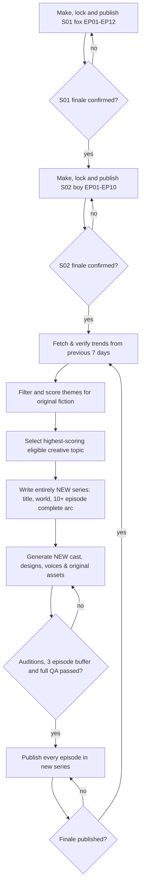

# AI DRAMA UNIVERSE — FULL UPDATED MASTER BLUEPRINT

**Version 2.0 | Updated 29 October 2026 | Zero-budget-first, local production**

**Mission:** Publish original AI short-drama stories as **complete series of at least 10 episodes each**. Main characters, outfits, settings and **matching character voices stay consistent across every scene and every episode of that series**. First publish exactly two preselected series, in order. **Only after both starter series end**, choose a high-scoring eligible topic from the previous 7 days of trends and make a completely new series with a new premise, fictional universe, main cast, character designs, voices and 10+ episode arc. Repeat after each later finale.

> This is a detailed design and ready-to-edit saved *project specification*, not a claim that reference images, voice audio, video renders or platform uploads have already been generated.

## 1. The non-negotiable master rules

1. **Exactly two starter series:** (1) **The Last Little Fox** — 12 episodes, animal hero; (2) **The Boy Who Forgot Tomorrow** — 10 episodes, human-led mystery. Do not substitute the trending series between them.
2. **10 episodes minimum in every future series.** Write the full ending and at least 10 distinct episode beats *before* release; target 10–12 episodes, 35–60 seconds per episode, one daily.
3. **One character = one stable character ID + visual specification + approved multi-view images + voice preset, accent and base speed for the entire series.** Every scene resolves the identity from a stored registry. No prompt-only character recreation after references are approved.
4. **Choose character-appropriate voices**, with one separate approved voice profile per named speaking role and an optional narrator. Once auditioned, freeze the voice settings and approved WAV sample for the whole series; emotions modify the performance, not the actor identity.
5. **After starter series #2 is fully published**, analyze trends from the **preceding seven days**, not seven days from when the story was first imagined. For series #3 onward, each completed finale triggers this process again.
6. **New everything per later series:** a fresh original premise, title, setting/world, main cast, character IDs, reference sheets, cast voice profiles, soundtrack concept, thumbnail look and season story arc. Reuse technical editing software/templates, **not** fictional intellectual property or an identical cast/voice profile. Reusing a limited licensed voice engine itself is fine; exact assigned acting profiles should be fresh, and a distinctly suitable unused preset is preferred.
7. **No paid dependency in the baseline workflow.** Prefer PC-hosted models and FFmpeg. A less powerful computer uses animated image scenes (motion-comic mode) rather than claiming guaranteed free Hollywood-like full animation.
8. **Quality gates:** Check episode chronology, visual/voice identity locks, copyright, natural pronunciation, audio presence, captions, video framing and cliffhangers; never release placeholders or half-rendered output.

## 2. Release roadmap — the exact order

| Release phase | What we produce | Episodes | Next action |
|---|---|---:|---|
| Launch Series 1 | **The Last Little Fox** — animal mystery / family drama | 12 | Publish all 12 in order |
| Launch Series 2 | **The Boy Who Forgot Tomorrow** — human sci-fi mystery | 10 | Publish all 10 in order |
| New Series 3 | Original story based on the strongest **eligible** topic from the last 7 days | 10+ | Create **new** cast, designs, voices and world |
| Series 4, 5, 6… | Repeat 7-day trend review **after each finale** | 10+ each | New story world and full character/voice records every time |

**Trigger:** `S01.E12 published -> start S02.E01`; `S02.E10 published -> collect and rank last-seven-day trends -> generate S03 bible/10+ episodes -> build & lock new characters and voices -> produce 3-episode buffer -> start S03.E01`. Then each later finale repeats the cycle. “Published” means platform success has been confirmed, not merely an exported MP4.

**Default channel setup:** English dialogue and English subtitles, 9:16 MP4 (1080 × 1920, H.264/AAC), daily **10:00 AM Africa/Cairo**, YouTube Shorts primary; TikTok and Instagram Reels if platform authorization permits. One per day means the first 22 episodes take at least 22 posting days, plus preproduction time.

## 3. Series 1: THE LAST LITTLE FOX — 12 episodes (animal-led)

**Synopsis:** Ember is falsely accused of causing a forest fire. He and three unlikely animal allies discover that the signal system failed and a faulty lantern was the true ignition source. Mystery, friendship, betrayal and one season-long emotional payoff. Original stylized 3D family-film aesthetics, with no copied franchise designs.

### Permanent cast and *suggested fixed* voices

| ID / character | Visible character identity | Kokoro voice | Voice character and direction |
|---|---|---|---|
| `s01_ember` — Ember, fox cub | Orange fox, white-tipped **left** ear, amber eyes, **teal scarf with one gold star** | `am_puck` at 1.07× | Young-sounding, curious, mischievous, emotional; speed drops during grief |
| `s01_moss` — Moss, old tortoise | Olive shell with spiral and small front-right crack, slow movement | `bm_george` at 0.87× | Deep, measured British mentor; wise pauses |
| `s01_luma` — Luma, owl | Ivory heart-shaped face, blue-gray speckled wings, gold eyes | `af_heart` at 0.94× | Soft, observant, steady, reassuring |
| `s01_ash` — Ash, wolf pup | Slate-gray wolf, pale blue eyes, notch in right ear and scar above right brow | `am_fenrir` at 0.94× | Low, guarded, a little rough; vulnerable when confessing |
| `s01_narrator` — Narrator | Voice-only | `bf_emma` at 0.97× | Gentle British cinematic storyteller |

**Important:** These are **specific available preset IDs** and creative voice matches, not actual verified audition results. Audition them and save the chosen WAV samples before marking approved. The voice is not changed episode-to-episode simply because the character feels sad or angry.

### All 12 episodes

| # | Episode | Story / end hook |
|---|---|---|

| 01 | The Night the Forest Burned | Ember sees lightning after the first flames; finds a luminous blue feather in ashes. **End:** Whose feather glows after fire? |

| 02 | Nobody Believed the Fox | The council blames Ember and exiles him; a hidden call guides him to Luma. **End:** An owl knows Ember by name. |

| 03 | The Owl's Secret | Luma reveals the signal alarm rang before the storm; someone silenced it. **End:** The missing bell rope was cut. |

| 04 | Footprints in the Rain | Ember follows wet tracks toward the forbidden river and finds a torn map. **End:** Wolf tracks end at a locked gate. |

| 05 | The Wolf Who Helped | Ash saves Ember from the water but secretly pockets the rest of the map. **End:** Ember sees the matching torn edge. |

| 06 | The Empty Nest | Luma vanishes while investigating; Moss finds her compass in a nest. **End:** The compass points beneath the dam. |

| 07 | The River of Lies | Ember decodes the compass and uncovers evidence the old dam warning failed. **End:** Scratching sounds come from behind a wall. |

| 08 | The Buried Gate | They find animals stranded behind an old spillway and a sabotaged gate lever. **End:** Ash recognizes his family insignia. |

| 09 | A Friend's Betrayal | Ash confesses his family hid the broken warning system to avoid blame. **End:** A new flood is racing toward the gate. |

| 10 | The Last Crossing | The team opens the channel while Ember risks being swept away. **End:** Ember disappears in the current. |

| 11 | Who Started the Fire? | Luma and Moss rescue Ember; evidence shows an unattended faulty signal lantern sparked the fire; the storm followed. **End:** Will the forest believe evidence over fear? |

| 12 | The Forest Remembers | Ash and his family confess; animals rebuild and honor Ember; the full central conflict ends. **End:** Finale: peaceful sunrise; no compulsory unresolved cliffhanger. |

### Immutable appearance prompt — Ember

```text
An original small russet-orange fox cub, white tip on the LEFT ear, large amber eyes,
cream muzzle and chest, fluffy tail with ivory tip, rounded youthful proportions,
a teal scarf around the neck with exactly ONE stitched golden star.
Original expressive cinematic 3D-style animal-drama aesthetic, consistent proportions,
soft detailed fur, dramatic forest light; no logos, no copied animated characters.
Use approved Ember front/side/three-quarter reference images; maintain identical features
in every frame and all 12 episodes. Vertical 9:16.
```

**Never** swap the ear marking, remove or change the star, change eye color or replace the approved voice. Other cast descriptions and audition lines are saved in `seasons/S01_the_last_little_fox/characters/character_registry.json`.

## 4. Series 2: THE BOY WHO FORGOT TOMORROW — 10 episodes

**Synopsis:** Noah, 12, remembers possibilities from tomorrow and finds a girl the city has erased from its memory. The clock tower's flawed memory shield is rewriting the past. This is a **different** universe and cast from the animal series. Its finale resolves the city-wide memory problem.

### Permanent cast and different voice presets

| ID / character | Visible character identity | Kokoro voice | Voice character and direction |
|---|---|---|---|
| `s02_noah` — Noah, boy | Short black curls, cobalt hooded jacket with white zigzag seam on **left sleeve**, dark trousers | `am_liam` at 1.10× | Brisk, uncertain, youthful; must audition for believable child-like delivery |
| `s02_mira` — Mira, girl | Auburn wavy hair, copper clip **right side**, yellow raincoat, navy satchel | `af_bella` at 1.07× | Witty, spirited, sometimes frightened |
| `s02_dr_vale` — Dr. Vale, scientist | Salt-and-pepper low bun, oval silver glasses, emerald vest | `af_nicole` at 0.96× | Grounded, intelligent, controlled guilt |
| `s02_clockkeeper` — Clockkeeper | Long yellow coat, black gloves, star-engraved pocket watch | `am_michael` at 0.91× | Low-key, deliberate, mysterious |
| `s02_narrator` — Narrator | Voice-only | `bm_fable` at 0.96× | Suspenseful, warm British male narration |

**Voice separation:** All **10 starting character/narrator voice IDs are distinct**, including between Series 1 and Series 2. Treat these as proposed baseline presets requiring audition/approval; some presets may not perfectly sound like children without careful casting.

### All 10 episodes

| # | Episode | Story / end hook |
|---|---|---|

| 01 | A Note From Tomorrow | Noah wakes with a note in his own handwriting warning him not to enter the clock tower. **End:** He sees himself entering it tomorrow. |

| 02 | The Girl No One Remembers | Mira claims they are friends, but every photo of her has vanished. **End:** Her name erases itself from Noah’s notebook. |

| 03 | The Clock That Runs Backward | They discover a city clock turns backward seven minutes at midnight. **End:** The clock strikes thirteen. |

| 04 | Seven Minutes Missing | Noah reviews missing security footage and finds an impossible extra street. **End:** The street appears outside his window. |

| 05 | The Man in the Yellow Coat | The Clockkeeper insists forgotten days protect the city and offers Noah a deal. **End:** He already owns a drawing of Noah’s future. |

| 06 | A Promise He Never Made | Noah finds a voice memo of a promise to Mira he cannot recall. **End:** Mira says Noah once agreed to erase her. |

| 07 | The City Stops at Midnight | Dr. Vale reveals a memory shield resets the city whenever it detects disaster. **End:** The shield begins resetting everyone permanently. |

| 08 | The Wrong Future | The team enters the clock system; alternate memories reveal the shield created the crisis. **End:** The Clockkeeper locks Mira inside the memory vault. |

| 09 | One Memory to Save | Noah must sacrifice his ability to glimpse tomorrow to restore Mira and everyone else. **End:** The lever is seconds from closing. |

| 10 | Tomorrow Begins Again | Noah disables the shield; Mira returns to everyone’s memories, the Clockkeeper changes course, and Noah learns to face uncertainty. **End:** Finale closes the principal plot; new seasons get a different universe. |

### Immutable appearance prompt — Noah

```text
An original 12-year-old boy with warm medium-brown skin, short curly black hair,
dark brown eyes, cobalt-blue hoodie with one white zigzag seam on LEFT sleeve,
charcoal trousers, well-worn white trainers. A childlike slender build and
expressive curious face. Atmospheric original futuristic city, glowing clocks,
cinematic stylized 3D dramatic lighting, vertical 9:16.
Use Noah's approved front/side/three-quarter references for every scene and episode.
Do not change his face, age, clothing or hair between scenes.
```

The full immutable cast, accents, voice speeds and reference locations are saved under `seasons/S02_the_boy_who_forgot_tomorrow/characters/`.

## 5. How the system actually SAVES characters and voices for the whole series

This is the most important technical update. **The creative files are included in the companion ZIP**, with permanent character IDs and hashed identity specifications. The *approved images and approved voice WAVs must still be generated* on your PC.

**One source of truth** — `seasons/<series_id>/characters/character_registry.json` stores, for each named speaking role:

- Stable `id` (`s01_ember`, `s02_noah`, etc.) and name, type, pronouns, story age, personality and emotional arc.
- Exact appearance: species/age, eye and fur/hair colors, identifying marks, clothing, proportions, permanent palette and `never_change` rules.
- `voice.engine`, `voice.voice_id`, `voice.lang`, **base speed**, speech style, audition dialogue and directions.
- `assets.front_ref`, `assets.side_ref`, `assets.three_quarter_ref`, `assets.voice_audition`, with status fields; these are expected paths, **not generated files**.
- An identity-spec lock and a stored fingerprint to catch accidental edits. Do not silently change a published character; version and review a justified change.

**Before episode 1:** Generate 3 approved views for every visible character; make a 5–15 second audition WAV with its voice preset; compare characters by sight and sound; approve and archive each file. Keep those approved files in a persistent local folder, plus a backup. Never rely on an ephemeral GitHub Actions runner or a free image-generation session to remember them.

**When writing/rendering an episode:** The script only says `character_id: s01_ember` and dialogue. The renderer loads the voice/palette/reference paths from the locked registry and uses approved images for image-to-image/video conditioning if the chosen local model supports it. If a required reference or voice sample is missing, **block publishing**; do not substitute a random look or voice. Store audio for completed scenes so later rerenders can preserve the original voice performance.

**Continuity automated tests:** Detect inconsistent identifiers, unknown character IDs, duplicated voice roles inside a series, altered identity hashes, missing approved images/WAVs, incorrect episode order, dialogue without an assigned actor, and new series accidentally inheriting old characters. The provided validator already covers registry counts, voice uniqueness and identity hashes; real asset-file and scene QA must be implemented before publishing.

**Voice acting policy:** Base voice preset/accent/voice rate never change for that character once auditioned and approved. Direct feelings through script, punctuation, pauses and restrained local speed effects. Re-audition any new preset *before* a season starts, never at episode 7. No impersonation or nonconsensual cloning of a real person's voice. Kokoro provides preset voices; it is not an arbitrary real-person voice cloning system.

## 6. Zero-cost software workflow, with genuine limits

| Job | Selected tool | Baseline/fallback |
|---|---|---|
| Script, bible, characters | Ollama plus an appropriately licensed local language model | Author/revise manually if hardware is limited |
| Character design & still images | ComfyUI + supported local image model | Original illustrated stills and references |
| Character scene animation | Compatible local image-to-video model (hardware permitting) | FFmpeg motion-comic: pans, zooms, parallax, cuts |
| Matching actor dialogue | **Kokoro-82M local**, one saved preset per character | Piper local, but **recast and lock before episode 1**, not mid-season |
| Foley / background music | Own original sounds or clearly licensed royalty-free assets | Soft original ambience; maintain license/credit log |
| Captions + edit | Python + FFmpeg (optional Kdenlive) | Burn in readable timed subtitles |
| Topic monitoring | Google Trends Trending Now, **past 7 days**, filtered by chosen market | Verified manual RSS / CSV export |
| Running jobs | Windows Task Scheduler and local Python; GitHub Actions for lightweight orchestration | Manual trigger / upload |
| Posting | YouTube Studio manual first; official API with working OAuth later | TikTok/Reels manually or authorized connectors |

**Kokoro chosen over Edge-TTS:** Existing Edge TTS websocket returned 403 in your earlier workflow; the new system is local-first and never requires that endpoint. Kokoro provides multiple actual voice presets, and the upstream model license is Apache-2.0. Review voice packs/dependencies and all other assets/model licenses for the intended use. <https://huggingface.co/hexgrad/Kokoro-82M>

**Realism:** Some computers cannot render high-end text-to-video locally; motion-comic mode keeps the story production possible, but isn't full 3D character animation. GitHub Actions free runners aren't free GPU render farms. Hardware, electricity, storage and public API quotas may still cost money. No guaranteed unlimited free Picsart or other hosted generative credits. For a Picsart-like editing workflow without subscriptions, use desktop free editors and reusable FFmpeg presets.

## 7. Exact per-episode creation process

1. Read the episode synopsis and fixed season bible; confirm which earlier cliffhanger must be resolved. Split into 3–7 visual scenes and 35–60 seconds total.
2. Create an action+dialogue JSON scene plan referencing existing `character_id`s, the same story locations, emotional direction, subtitle line and sound cues; no fresh unregistered protagonists.
3. Load the approved character 3-view PNGs and the identity prompt from the registry. Use reference-guided generation and compare against the exact approved costume, colors and body proportions; reject inconsistent images.
4. Make action clips with the locally supported video model; if it fails or hardware cannot run it, use saved stills with animated camera work/parallax. Do not switch style every episode.
5. Generate **each character's dialogue** with their locked voice ID, speed and accent. Render narration separately with its own voice. Verify that who speaks matches the script; do not fall back to the narrator for a character without explicit editorial approval.
6. Mix voice lines, original/licensed environmental sounds and appropriate music; ensure intelligibility and natural pauses. Keep a verified sound license index.
7. Add big readable captions, a first-3-second emotional hook, coherent visual transitions and a genuine cliffhanger (the finale resolves the plot).
8. Export 1080×1920 H.264/AAC MP4. QA audio presence, correct duration and aspect ratio, no broken frame, word timing, title, character appearance and voice. Do not upload if QA fails.
9. Store source scene JSON, stills, generated clips, voices, captions, render, episode metadata and QC result under that season and episode. Never overwrite a successful release render without version history.
10. Publish when the platform confirms successful upload, tracking platform video ID. If a network outage occurs, queue and retry without duplicating the episode.

**Episode timing guideline:** 0–3s hook; 3–12s situation; 12–30s escalation; 30–45s twist; 45–60s cliffhanger or final-season payoff. For 35 seconds, shorten acts but preserve clarity. Approximately 70–110 spoken English words depending on speed and pauses.

## 8. New-series generation logic: ONLY after the two starters



**Time of review:** Collect verified trends at the actual time S02 finale is published, then after later finales. Google Trends' 7-day filter and export (RSS or CSV) are official features. A trend in one market isn't automatically worldwide; note market, timestamps and sources. <https://support.google.com/trends/answer/3076011?hl=en>

**Safety/editorial filter:** Exclude real-person allegations, tragedies, misinformation, privacy-invasive subjects, and existing famous fictional characters or copyrighted story plots. Convert safe broad *themes* into completely original fiction (e.g., space curiosity -> a new desert creature discovering a moving star). No false claim a story is based on true events.

**Rank 0–100:** momentum 25; drama/emotion 25; can sustain 10+ meaningful episodes 20; new visual design potential 15; production feasibility 10; audience match 5. Select the **top eligible** score of >=65; if none reaches 65, choose an evergreen original premise instead of a harmful trend. Store scoring, proof of freshness, date, source URL and rationale.

**Brand-new all-the-way rule:** Don't carry over Ember/Noah or their reference art; don't reuse the old series' fictional universe, title, story beats, character IDs or character voice profiles. Create fresh multi-view character sheets and new voice tests before episode 1. Reusing the Python toolchain and caption style is allowed. If the available presets do not offer genuinely differentiated new voice profiles, add another legitimate free/local voice pack or record original performances; never claim a new voice exists when it doesn't.

**New series prep requirements:** 10–12 episode outline; season-ending solution; fresh character bible; character voice direction and approved audition; first 3 ready episodes; no published mid-season revamps. After the finale, repeat the same seven-day trend logic indefinitely subject to available hardware and real publishing permissions.

## 9. Project folder design — delivered with this update

```text
AI_Drama_Universe_v2/
  README.md
  config.json
  data/
    series_registry.json                # fixed S01 -> S02 -> trend-only-after-S02 order
    identity_fingerprints.json          # frozen hashes of all 10 initial cast profiles
    trend_candidates_TEMPLATE.csv      # illustrative, NOT actual current trends
  seasons/
    S01_the_last_little_fox/
      series_manifest.json
      series_bible.md
      characters/
        character_registry.json       # all visual details + 5 fixed voice profiles
        s01_ember/approved_front.png  # FUTURE asset, not included
        ...                            # approved side, 3/4, approved voice WAV
      episodes/episodes.json          # all 12 episodes
    S02_the_boy_who_forgot_tomorrow/
      series_manifest.json
      series_bible.md
      characters/character_registry.json # 5 other fixed voice profiles
      episodes/episodes.json          # all 10 episodes
  templates/
    episode_scene_TEMPLATE.json
    new_series_ollama_prompt.md
  tools/
    validate_project.py
    season_status.py
    rank_trends.py
    lock_character_assets.py        # hash actual approved multi-view PNGs and WAVs
```

**Storage:** Keep small JSON, scripts and bibles in a Git project, and large approved images, WAV files and video files on a persistent local folder with another backup. Update `asset` paths to match the machine before rendering. Generated files cannot be recovered from an ephemeral runner if not saved.

## 10. Verification and fail-safe rules

- **Identity mismatch:** Stop scene production or reject it if the character no longer matches approved reference images, marks, clothing, proportions or voice; do not silently let character drift accumulate.
- **Voice fault:** Retry Kokoro locally; if backend must change, it must be recast, auditioned and approved *before* the series releases; after release, hold the episode rather than changing the actor mid-season.
- **Missing ref files:** The manifest has expected filenames only. If PNGs/WAVs don't exist, no production publish approval.
- **Trend feed unavailable:** Don't fabricate a top trend or pretend to know what's highest. Keep the decision pending until fresh seven-day data can be verified, or use a logged evergreen fallback.
- **Mid-series trend spikes:** Do not abandon the current story or skip its finale; finish the complete season first.
- **New season too short:** Reject a draft with fewer than ten **substantive** episodes; avoid filler or copying old plots.
- **API outage:** Retain rendered MP4, use queue, retry conservatively, track platform video IDs and prevent duplicate posting.
- **YouTube access:** Official `videos.insert` requires OAuth credentials and appropriate permissions. The blueprint does **not** imply the account is connected. <https://developers.google.com/youtube/data/reference/rest/v3/videos/insert>
- **Local hardware too weak:** Use motion-comic render path and keep asset and voice continuity rather than relying on dubious “unlimited free” cloud claims.
- **Child characters:** Voices are original synthetic presets, not cloned from actual children. Keep characters and stories age-appropriate and original.
- **Approval gate:** No series begins until its cast references and voice auditions are approved, 10+ scripts/outline+finale are in place, and its first 3 episodes are buffered.

## 11. Commands included and what is *not* implemented yet

From inside the extracted companion folder, run:

```powershell
python tools/validate_project.py
python tools/season_status.py
python tools/rank_trends.py data/trend_candidates_TEMPLATE.csv
# After you create/approve 3 Ember reference PNGs and audition WAV:
python tools/lock_character_assets.py S01_the_last_little_fox s01_ember
python tools/lock_character_assets.py --verify
```

- Validator: checks two launch series, 22 episode entries, 10 unique cast voice IDs, and unchanged locked identity hashes.
- Asset-lock helper: only after images/WAV are generated and approved, record real file SHA-256 hashes; refuse missing/fake or changed files and verify them before publishing. No actual approved assets are included yet.
- Status command: shows that Series 1 is next; it does **not** start uploading or silently mark episodes published.
- Trend ranker: ranks **provided, verified and editorially scored** CSV rows. The sample CSV contains an **illustrative fake topic**, not a live trend.
- Writer prompt: ready to be supplied to a suitable local Ollama model after the S02 finale and real weekly trend lookup.

**Not included:** Approved character PNGs, actual voice WAV files, installed local AI models, rendered episodes, auto-generated future series, a running scheduler, or connected YouTube/TikTok/Instagram credentials. These are future implementation steps, not features secretly operating now.

**First execution milestone:** Generate and approve Ember's three reference views, audition all 5 Series 1 voices, make a 35–60-second Episode 1 sample, and compare every shot and line against the locked identities before batch-producing the rest.

## 12. End-to-end release checklist

- [x] Exact starter order defined: fox 12 episodes, then boy 10 episodes.
- [x] All starter episode titles, plot beats, finales and cliffhangers documented.
- [x] 10 cast/narrator identity and voice configurations stored across two JSON character registries.
- [x] Visual and voice spec lock fingerprints prepared; scripted verification included.
- [x] Weekly trend gate updated: **do not trend-select between the first two series**.
- [x] Template for wholly new season concepts and trend ranking included.
- [ ] Download/test local model(s), software and voice presets on the actual computer.
- [ ] Generate, inspect and save approved reference PNGs and matching voice-audition WAVs.
- [ ] Implement real scene rendering and audio-mixing automation using references.
- [ ] Render and inspect episode one, then first-three-episode release buffer.
- [ ] Configure and verify any publishing OAuth/authorized external platforms.
- [ ] Publish all 12 of S01, then all 10 of S02.
- [ ] At S02 finale, gather genuine current 7-day trend candidates and make a new original S03.

## 13. Reference links

- Kokoro official model and license: https://huggingface.co/hexgrad/Kokoro-82M
- Kokoro official implementation: https://github.com/hexgrad/kokoro
- Google Trends official 7-day filter/RSS: https://support.google.com/trends/answer/3076011?hl=en
- Google Trends: https://trends.google.com/trending
- ComfyUI: https://github.com/Comfy-Org/ComfyUI
- FFmpeg: https://ffmpeg.org/
- Ollama: https://ollama.com/
- YouTube upload API: https://developers.google.com/youtube/data/reference/rest/v3/videos/insert

---

**Final concept:** Two deliberately planned pilot mini-series, followed by an open-ended original AI drama studio that reacts to the *most appropriate* topics of each preceding week without sacrificing character continuity, coherent seasons, distinctive voices or a $0-subscription local-first production path.
